# SAVIA — examen N.º 1

Proyecto estático HTML + CSS. Abrir `index.html` en el navegador. No necesita dependencias.

El sitio incluye la página Inicio y las plantillas `pages/menu.html`, `pages/equipo.html` y `pages/eventos.html` con contenido central pendiente. Siga exclusivamente las especificaciones del examen para conocer el comportamiento esperado. No modifique el tema general ni sustituya el proyecto por otro.

## Diagnóstico de cinco incidencias

| N.º | Comportamiento observado | Causa técnica y ubicación | Corrección realizada | Prueba de verificación | Autor |
|---|---|---|---|---|---|
| 1 | Se observan las 3 tarjetas en manera de columna y no una al lado de la otra como se pide| El CSS tiene la distrubucion en columna |Se cambia el flex-direction a row |Error: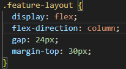 Ya corregido: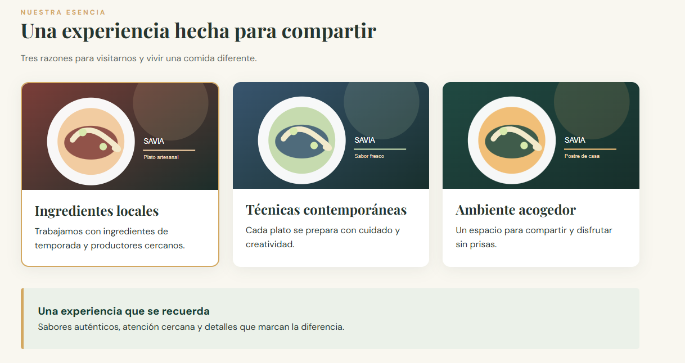 |Ana Gonzalez |
| 2 |Al hacer click en nuestra carta se dirige a eventos en lugar de menu |La referencia en el index de inicio en la parte de navbar tenia el link incorrecto | se le cambio el link eventos.html por menu.html |Error: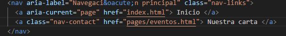 solucionado 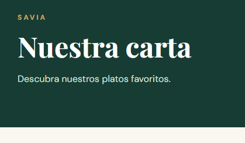| Rachel Santamaria|
| 3 |No se redireccionaba a ninguna pagina |Habia un "#" en lugar de la ruta menu.html|Se le asigno la ruta solicitada, menu.html |Error: 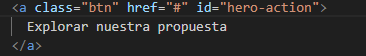 Solucion: 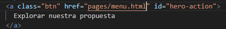 |Ana y Rachel|
| 4 |El boton se mostraba de color rojo |Se encontro en el css una accion de hero que le daba el color al boton |Se cambia al color a var(--gold) |Error: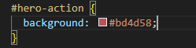 Correcion: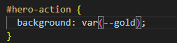 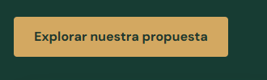|Ana y Rachel |
| 5 |Al cambiar el ancho de la pagina la navegacion seguia en la misma fila que el logotipo |En el CSS, el @media tenia un max-width de 760 px |Se cambio a una medida de 374 px para que al estar la pagina en 375px se pueda visualizar la navegacion debajo del logotipo | Error: 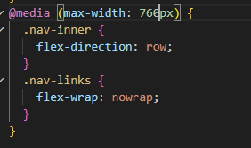 Solucion: 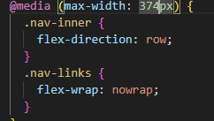 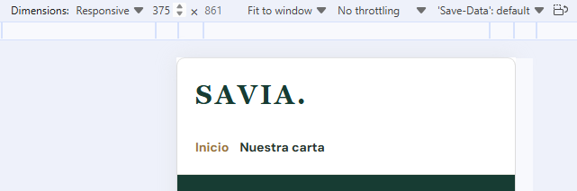|Ana y Rachel |

## Responsables de las funcionalidades

| Estudiante | Página asignada | Rama | Commits principales |
|---|---|---|---|
| | | | |

## Evidencias Git

| Funcionalidad/corrección | PR hacia develop | Revisor | Resultado de merge / conflicto si ocurrió |
|---|---|---|---|
| | | | |

## Verificación final
Registrar las pruebas de funcionamiento a 1280 px y 375 px, enlaces y páginas.
try